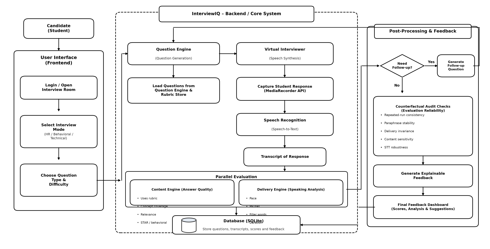

# InterviewIQ: GenAI-Based Virtual Interviewer for Placement Coaching

[](https://fastapi.tiangolo.com)
[](https://python.org)
[](https://sqlite.org)
[](https://github.com/openai/whisper)
[](https://github.com/tensorflow/tfjs-models)

> **Research Paper Project**  
> **Title:** GenAI-Based Virtual Interviewer for Placement Coaching  
> **Authors:** Paavana B V, Raina Indikar, Salma Sunaina, Viral Mehta  
> **Under the Guidance of:** Dr. J Sangeetha  
> **Department of Computer Science & Engineering**, Ramaiah Institute of Technology, Bangalore, India  

---

## 📌 Overview

**InterviewIQ** is an intelligent, automated mock interview platform designed to prepare students for campus placements. Unlike traditional subjective evaluations or high-stakes hiring filters, InterviewIQ functions strictly as a **formative coaching system**. It offers students realistic, real-time interview practice with voice-based interaction, instant dual-engine evaluation (Content & Delivery), automated follow-up questioning, and in-browser proctoring.

---

## 🏗️ System Workflow Architecture

<p align="center">
  
</p>

The platform architecture follows a 3-tier pipeline:
1. **Frontend / Candidate Interface:** Session initialization, difficulty/mode selection, camera & microphone calibration, and client-side proctoring.
2. **Backend / Core Engine:** Dynamic Question Generation, Text-to-Speech (TTS), audio capture via MediaRecorder, Speech-to-Text transcription (Whisper), and parallel evaluation (Content + Delivery).
3. **Post-Processing & Feedback:** Adaptive follow-up routing, counterfactual audit checks, SQLite persistence, and comprehensive feedback generation.

---

## ✨ Key Features

- **🎙️ Voice-Based Conversational Interface:** The virtual interviewer vocalizes questions using Text-to-Speech (TTS), and candidates respond naturally by speaking into their microphone.
- **⚡ Fast Speech Recognition (STT):** Audio responses are accurately transcribed into text using OpenAI Whisper.
- **🧠 Parallel Dual-Engine Evaluation:**
  - **Content Engine (What was said):** Evaluates technical depth, correctness, rubric concept coverage, and STAR methodology adherence using pre-trained LLMs (Gemini / Nemotron).
  - **Delivery Engine (How it was said):** Automatically measures speaking pace (words per minute), pauses, response duration, and filler word frequency (*"um"*, *"uh"*, *"like"*).
- **🎯 Dynamic Interview Modes & Difficulties:**
  - **Modes:** Technical (DBMS, OS, CN, DSA), Behavioral (Leadership, Conflict, Teamwork), and Mixed.
  - **Difficulties:** Easy, Medium, and Hard with calibrated question quotas and follow-up loops.
- **🛡️ In-Browser Proctoring:** Lightweight TensorFlow.js `COCO-SSD` model runs directly inside the client browser to monitor camera presence, multiple persons, and tab switching without sending raw video feeds to the backend.
- **📊 Comprehensive Feedback Dashboard:** Generates an overall readiness score, category breakdowns, strengths, missed concepts, and actionable coaching tips.

---

## 🚀 Quick Start & Execution

### Prerequisites
- **Python 3.11+**
- Modern web browser (Google Chrome or Microsoft Edge recommended)
- Working webcam and microphone

### 1. One-Click Start (Windows)
Double-click the `start_server.bat` file in the project root directory.

### 2. Manual Terminal Commands
Alternatively, launch the server directly from PowerShell or Command Prompt:

```powershell
# Step 1: Navigate to the project directory
cd C:\Users\Admin\Downloads\GEN\place\interviewiq

# Step 2: Start the FastAPI application server
python -m uvicorn app.main:app --host 127.0.0.1 --port 8001
```

### 3. Open in Browser
Once the server is running, navigate to:
- **InterviewIQ Portal:** [http://127.0.0.1:8001](http://127.0.0.1:8001)
- **Interactive API Documentation:** [http://127.0.0.1:8001/docs](http://127.0.0.1:8001/docs)

---

## ⚙️ Environment Configuration (`.env`)

Configure your environment settings in the `.env` file:

```env
# Evaluation Mode
LLM_PROVIDER=live

# Pre-Trained LLM Judge Configuration (OpenRouter / Gemini / Nemotron)
JUDGE_1_NAME=judge_nemotron_ultra
JUDGE_1_PROVIDER=openai_compatible
JUDGE_1_BASE_URL=https://openrouter.ai/api/v1
JUDGE_1_API_KEY=your_api_key_here
JUDGE_1_MODEL=nvidia/nemotron-3-ultra-550b-a55b:free

# Whisper Speech-to-Text
WHISPER_MODEL_SIZE=base
WHISPER_DEVICE=cpu
WHISPER_COMPUTE_TYPE=int8

# Database (Default: Local SQLite with WAL mode)
DATABASE_URL=sqlite:///interviewiq.db
```

To verify your configuration and judge connectivity:
```powershell
python check_config.py
```

---

## 📂 Project Structure

```
interviewiq/
├── app/
│   ├── api/
│   │   └── routes/          # FastAPI REST endpoints (interview, proctor, results)
│   ├── engines/
│   │   ├── content.py       # Content Engine (rubric & conceptual scoring)
│   │   ├── delivery.py      # Delivery Engine (WPM, pauses, filler words)
│   │   └── holistic.py      # Aggregation & final scoring logic
│   ├── models/              # SQLAlchemy database models
│   ├── services/
│   │   ├── llm.py           # LLM judge routing & dynamic question generation
│   │   ├── stt.py           # Whisper speech-to-text service
│   │   └── judge_config.py  # Model judge provider configs
│   └── static/              # Web application frontend
│       ├── index.html       # Landing & setup dashboard
│       ├── interview.html   # Active proctored interview room
│       ├── results.html     # Results & analytics dashboard
│       └── interviewiq_workflow.png # Architecture diagram
├── data/                    # Benchmark reference items and rubrics
├── experiments/             # Audit experiment logs and runs
├── tests/                   # Automated test suites
├── interviewiq.db           # SQLite database
├── start_server.bat         # Windows one-click start script
├── pyproject.toml           # Project dependencies & packaging
└── README.md                # Project documentation
```

---

## 🧪 Counterfactual Audit Checks

The system includes research-grade counterfactual audit suites to evaluate scoring reliability across 5 dimensions:
1. **Repeated-run consistency:** Measuring scoring variance across identical runs.
2. **Paraphrase stability:** Verifying score invariance under semantic paraphrasing.
3. **Delivery invariance:** Ensuring delivery metrics do not improperly penalize content scores.
4. **Content sensitivity:** Confirming that factual errors directly lower content scores.
5. **STT robustness:** Evaluating tolerance against transcription noise.

Run tests using:
```powershell
pytest
```

---

## 📄 License & Academic Attribution
Developed for academic placement coaching and research at Ramaiah Institute of Technology (MSRIT). Formative coaching only — not for automated hireability decisions.
